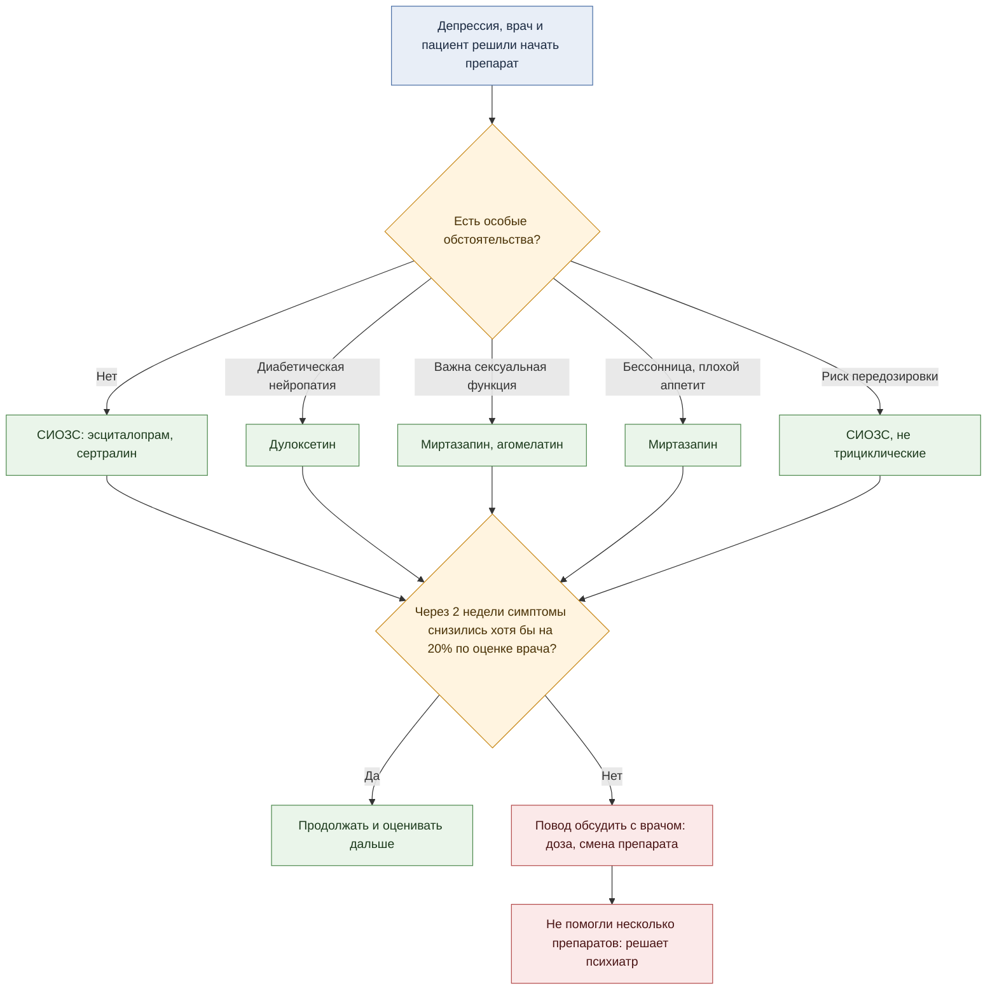

Антидепрессантов больше двух десятков. Со стороны выбор между ними похож на лотерею: одному выписали эсциталопрам, другому миртазапин, третьему дулоксетин. На деле за выбором стоит понятная логика, и её можно разложить на карту. На ней видно, как препараты устроены, насколько они сильны, чем за каждый приходится платить и почему конкретному человеку дают конкретную таблетку.

Сразу оговорка: это не инструкция. Препарат и дозу подбирает врач. Он смотрит на то, чего в статье нет: на историю болезни, другие лекарства, беременность, сопутствующие болезни. Работают ли антидепрессанты вообще и что стало с серотониновой теорией, я разбирал [отдельно](/blog/science/mind/serotonin-theory-and-ssri/), а как они складываются с психотерапией, [тоже отдельно](/blog/science/mind/therapy-plus-pills/). Эта статья про то, как устроена сама аптечная полка.

---

## Коротко: что это и как работает

**Что лечат.** Главное показание это большая депрессия. Многие препараты из этой группы применяют и шире: при тревожных расстройствах и обсессивно-компульсивном расстройстве, дулоксетин при болевой диабетической нейропатии, бупропион при отказе от курения. Поэтому «антидепрессант» скорее название группы, чем точное описание того, что препарат делает.

**Как действуют.** Серотонин, норадреналин и дофамин это вещества, через которые нервные клетки передают сигнал друг другу. Почти все антидепрессанты так или иначе меняют их работу: мешают клеткам забирать их обратно, блокируют фермент, который их разрушает, или действуют на рецепторы, которые их принимают. Химия меняется за часы, а настроение через недели, и почему так, до конца не известно. Простая схема «не хватает серотонина, таблетка добавляет» не подтвердилась, об этом [отдельная статья](/blog/science/mind/serotonin-theory-and-ssri/).

**Чего ждать.** Побочные эффекты часто приходят раньше пользы. Первые признаки улучшения стоит оценивать примерно через две недели, об этом в пятой части. Прекращать приём лучше постепенно и вместе с врачом.

**Как читать дальше.** Часть I про классы и механизмы. Часть II про силу и переносимость. Часть III про цену: побочные эффекты и риски. Часть IV про выбор: там схема и сводные таблицы с торговыми названиями. Часть V про первые недели и отмену. Если нужен только итог, переходите сразу к части IV.

---

## Часть I. Как их делят

Классы антидепрессантов называют по тому, что препарат делает в синапсе, то есть в месте контакта двух нервных клеток. Механизм показывает, с чего действие начинается, но не объясняет, почему через недели человеку становится лучше. Для карты он всё равно полезен: от механизма зависят побочные эффекты.

**СИОЗС**, селективные ингибиторы обратного захвата серотонина: флуоксетин, сертралин, пароксетин, циталопрам, эсциталопрам, флувоксамин. Обычно клетка, выпустив серотонин, забирает его обратно. Эти препараты ей мешают, и серотонина в синапсе остаётся больше. «Селективные» значит, что на другие системы они действуют мало, поэтому переносятся лучше старых препаратов.

**СИОЗСН**, ингибиторы обратного захвата серотонина и норадреналина: венлафаксин, дезвенлафаксин, дулоксетин. Делают то же самое, но сразу для двух веществ.

**Трициклические**, один из двух первых классов: амитриптилин, имипрамин, кломипрамин. Они тоже мешают обратному захвату, но вдобавок действуют на много посторонних рецепторов: гистаминовые, холинергические, адренергические. Отсюда сухость во рту, запоры, сонливость, падение давления при вставании. А при передозировке они ещё и нарушают проводимость в сердце, поэтому так опасны.

**ИМАО**, ингибиторы моноаминоксидазы: фенелзин, моклобемид. Они блокируют фермент, который разрушает серотонин, норадреналин и дофамин. Старые необратимые ИМАО требуют диеты. Без этого фермента вещество тирамин из выдержанного сыра, копчёностей и некоторых других продуктов может резко поднять давление. Не менее опасно сочетать их с другими препаратами, которые повышают серотонин. Так можно получить серотониновый синдром, опасное отравление избытком серотонина, поэтому при переходе на ИМАО или с них нужна пауза.

**Остальные** устроены каждый по-своему. Бупропион действует на норадреналин и дофамин, а серотонин почти не трогает. Миртазапин блокирует рецепторы, которые тормозят выброс норадреналина и серотонина, и заодно сильно блокирует гистаминовые рецепторы, отсюда сонливость и аппетит. Агомелатин стимулирует рецепторы мелатонина и блокирует один из серотониновых рецепторов. Вортиоксетин сочетает блокаду обратного захвата серотонина с действием на несколько его рецепторов. Тразодон в малых дозах работает в основном как снотворное, в больших как антидепрессант.

---

## Часть II. Насколько они разные по силе

Самое большое сравнение сделала группа Андреа Чиприани [в Lancet в 2018 году](https://pubmed.ncbi.nlm.nih.gov/29477251/). Это метаанализ, то есть сводный разбор многих исследований: 21 антидепрессант, 522 испытания. Все 21 оказались эффективнее плацебо, таблетки-пустышки, при большой депрессии у взрослых.

Разброс при этом заметный. Силу здесь считали как отношение шансов на ответ: во сколько раз шансы, что лечение подействует, выше, чем на плацебо. Единица значит «без разницы». Сильнее всех выглядел амитриптилин, 2,13. Слабее всех ребоксетин, 1,37.

Когда препараты сравнивали напрямую друг с другом, лучше по эффективности выглядели агомелатин, амитриптилин, эсциталопрам, миртазапин, пароксетин, венлафаксин и вортиоксетин. Хуже флуоксетин, флувоксамин, ребоксетин и тразодон.

По переносимости, то есть по тому, как часто люди бросали лечение, картина другая. Только агомелатин и флуоксетин бросали реже, чем плацебо, и только кломипрамин чаще. Остальные от плацебо не отличались. В прямых сравнениях лучше переносились агомелатин, циталопрам, эсциталопрам, флуоксетин, сертралин и вортиоксетин, хуже амитриптилин, кломипрамин, дулоксетин, флувоксамин, ребоксетин, тразодон и венлафаксин.

Самый «сильный» амитриптилин переносится хуже многих, а более слабый флуоксетин переносится одним из лучших. Разница в силе между большинством препаратов умеренная, а уверенность в этих данных сами авторы оценили где-то между умеренной и очень низкой. Поэтому, по-моему, при выборе разумно смотреть прежде всего на цену, которую человек готов платить.

---

## Часть III. Чем платишь

**Сексуальная функция.** [Метаанализ Серретти и Кьезы 2009 года](https://pubmed.ncbi.nlm.nih.gov/19440080/) нашёл, что сексуальные нарушения значимо чаще, чем на плацебо, бывают у сертралина, венлафаксина, циталопрама, пароксетина, флуоксетина, имипрамина, фенелзина, дулоксетина, эсциталопрама и флувоксамина. Частота у них разная, от 25,8 до 80,3% пациентов в зависимости от препарата. Оговорка авторов: в анализ вошли и открытые исследования, где пациенты и врачи знали, какой препарат назначен, и разные шкалы оценки. Не отличались от плацебо агомелатин, бупропион, моклобемид, миртазапин и ещё два препарата, которые сейчас почти не используют.

**Вес.** [Британское когортное исследование 2018 года](https://pubmed.ncbi.nlm.nih.gov/29793997/) по записям почти 295 тысяч человек показало, что у принимающих антидепрессанты прибавка веса на 5% и больше случается на 21% чаще. На второй год лечения это примерно один дополнительный такой случай на 27 человек, и повышенный риск держался минимум шесть лет наблюдения. Данные наблюдательные: исследователи смотрели на записи врачей, эксперимента не было, поэтому это связь, и причину она не доказывает.

**Передозировка.** Для человека с суицидальными мыслями это не абстракция. [Работа Хоутона 2010 года](https://pubmed.ncbi.nlm.nih.gov/20435959/) сравнила, насколько часто отравление разными антидепрессантами заканчивается смертью: смотрели на соотношение смертельных и несмертельных отравлений. В условных единицах у трициклических показатель оказался 13,8, у венлафаксина 2,5, у миртазапина 1,9, у СИОЗС 0,5. То есть по этому показателю венлафаксин примерно в пять раз токсичнее СИОЗС, а трициклические почти в тридцать. Другие препараты, например бупропион, в этой работе не сравнивали. Разница есть и внутри классов: среди трициклических дозулепин и доксепин токсичнее амитриптилина, среди СИОЗС циталопрам опаснее остальных.

**Возраст.** [Анализ FDA 2009 года](https://pubmed.ncbi.nlm.nih.gov/19671933/) по 372 испытаниям и 99 231 взрослому показал, что риск суицидальных мыслей и поведения на антидепрессантах сильно зависит от возраста. У пациентов с психиатрическими диагнозами младше 25 лет шансы суицидального поведения на препарате были в 2,3 раза выше, чем на плацебо. Точность оценки невысокая: если учесть погрешность, это может быть и почти без разницы, и в пять раз выше (интервал от 1,04 до 5,09). От 25 до 64 лет эффект на поведение нейтральный. После 65 риск на антидепрессантах был ниже, чем на плацебо. Поэтому молодых пациентов на антидепрессантах наблюдают внимательнее, и FDA вынесло это в предупреждение на упаковке.

---

## Часть IV. Кому что

Если сложить механизм, силу и цену, получается карта, по которой может двигаться врач. Это логика выбора. Жёстким алгоритмом или клиническими рекомендациями её считать не стоит.

| Ситуация | О чём может подумать врач | На чём держится |
|---|---|---|
| Обычный первый эпизод | СИОЗС, например эсциталопрам или сертралин | У Чиприани эсциталопрам среди самых эффективных и среди лучше переносимых, сертралин среди лучше переносимых. СИОЗС наименее токсичны при передозировке у Хоутона, хотя циталопрам среди них опаснее остальных |
| Депрессия плюс диабетическая нейропатия | Дулоксетин | [Cochrane 2014](https://pubmed.ncbi.nlm.nih.gov/24385423/): при диабетической нейропатии 60 мг дулоксетина за 12 недель дают половинное снижение боли одному дополнительному человеку из пяти. Для боли при депрессии эффект в том же обзоре слабее, один из восьми, и доказательства низкого или умеренного качества |
| Депрессия плюс желание бросить курить | Бупропион, в России нет действующей регистрации | [Cochrane 2020](https://pubmed.ncbi.nlm.nih.gov/32319681/): по 45 испытаниям с бупропионом курить бросают надолго примерно в 1,6 раза чаще (отношение рисков 1,64). Для СИОЗС такого эффекта не нашли. Но это данные по курильщикам вообще: про пользу именно при депрессии обзор пишет, что данных мало и они противоречивы |
| Важна сексуальная функция | Миртазапин, агомелатин; бупропион там, где он доступен | Не отличались от плацебо в метаанализе Серретти |
| Бессонница и плохой аппетит | Миртазапин | Сонливость и аппетит у него прямое следствие механизма, здесь их можно использовать |
| Риск передозировки | СИОЗС; трициклических избегают | У Хоутона самая высокая смертность при отравлении у трициклических, у венлафаксина и миртазапина она тоже выше, чем у СИОЗС |
| Не помогли несколько препаратов | Это уже решает психиатр: смена класса, усиление другим препаратом, психотерапия | Работа Чиприани таких пациентов почти не включала, поэтому из неё здесь выводов не сделать |

Таблица упрощает. В реальном выборе ещё есть взаимодействия с другими лекарствами, беременность и кормление, болезни сердца и печени, прошлый опыт человека и его родственников с конкретным препаратом.

### Сводная карта препаратов

Основные препараты из статьи, по классам. В первой колонке жирным международное название (МНН): это название самого вещества, одинаковое у всех производителей, по нему препарат ищут в справочниках. Под ним торговые названия, под которыми препарат продают в аптеке. Названия сверены по справочнику Видаль для России в октябре 2026 года, и это не полный список: у многих веществ есть ещё дженерики под своими марками. В других странах СНГ набор может отличаться.

**СИОЗС**

| Препарат и названия | Чем выделяется | Главная цена |
|---|---|---|
| **Эсциталопрам** Ципралекс, Селектра, Ленуксин, Элицея | Среди самых эффективных и лучше переносимых у Чиприани | Сексуальные нарушения; среди частых по симптомам отмены |
| **Сертралин** Золофт, Асентра, Стимулотон, Серената | Среди лучше переносимых у Чиприани | Сексуальные нарушения |
| **Флуоксетин** Прозак, Профлузак, Флуоксетин Ланнахер | Бросали реже, чем плацебо | Слабее в прямых сравнениях; сексуальные нарушения |
| **Пароксетин** Паксил | Среди эффективных в прямых сравнениях | Сексуальные нарушения; среди самых тяжёлых по отмене |
| **Циталопрам** Ципрамил | Среди лучше переносимых | Самый токсичный из СИОЗС при передозировке |
| **Флувоксамин** Феварин, Рокона и другие | | Слабее и хуже переносится в прямых сравнениях; сексуальные нарушения |

**СИОЗСН**

| Препарат и названия | Чем выделяется | Главная цена |
|---|---|---|
| **Венлафаксин** Велаксин, Велафакс, Алвента | Среди эффективных в прямых сравнениях | Сексуальные нарушения; хуже переносится; токсичнее СИОЗС; частые и тяжёлые симптомы отмены |
| **Дулоксетин** Симбалта, Дулоксента, Депратал | Диабетическая нейропатия | Хуже переносится в прямых сравнениях; сексуальные нарушения |

**Другие механизмы**

| Препарат и названия | Чем выделяется | Главная цена |
|---|---|---|
| **Миртазапин** Каликста, Мирзатен Ку-таб, Миртазапин Канон | Среди эффективных; сексуальная функция не хуже, чем на плацебо | Сонливость и аппетит; токсичнее СИОЗС при передозировке |
| **Агомелатин** Вальдоксан, Агомелатин Канон и другие | Один из двух, кого у Чиприани бросали реже, чем плацебо; сексуальная функция не хуже, чем на плацебо | |
| **Вортиоксетин** Бринтелликс | Среди эффективных и лучше переносимых | |
| **Тразодон** Триттико | В малых дозах как снотворное | Слабее и хуже переносится в прямых сравнениях |
| **Бупропион** Веллбутрин, в России нет действующей регистрации | Отказ от курения; сексуальная функция не хуже, чем на плацебо | В России официально недоступен |

**Трициклические и ИМАО**

| Препарат и названия | Чем выделяется | Главная цена |
|---|---|---|
| **Амитриптилин** под МНН | Сильнее всех против плацебо у Чиприани | Хуже переносится; трициклические самые токсичные при передозировке |
| **Кломипрамин** Анафранил, Клофранил | | Единственный, кого бросали чаще, чем плацебо |
| **Моклобемид** (ИМАО) Аурорикс, в России нет действующей регистрации | Сексуальная функция не хуже, чем на плацебо | В России официально недоступен; опасные сочетания с другими серотониновыми препаратами |

Пустая клетка значит только то, что в источниках статьи по этой колонке ничего заметного не нашлось. Цена может быть и у этих препаратов. В России популярны и тианептин, и пипофезин, но ни в одном из источников статьи их нет, поэтому на этой карте их тоже нет.

---

## Часть V. Время и отмена

**Первые две недели.** Принято говорить, что антидепрессант начинает работать через месяц. Но [метаанализ Сегеди 2009 года](https://pubmed.ncbi.nlm.nih.gov/19254516/) по 41 испытанию и 6562 пациентам показал, что ранние признаки важны. Если за первые две недели симптомы по оценке врача не снизились хотя бы на 20%, шанс на устойчивый результат потом низкий: среди таких пациентов от 82 до 100% так и не дали устойчивого ответа или ремиссии. Работа построена на испытаниях миртазапина и препаратов сравнения, но сама идея полезна: через две недели уже есть повод обсудить с врачом, туда ли идёт лечение.

**Отмена.** [Метаанализ Хенсслера 2024 года](https://pubmed.ncbi.nlm.nih.gov/38851198/) по 79 исследованиям и 21 002 пациентам нашёл хотя бы один симптом отмены у 31% прекративших антидепрессант. Но и у прекративших плацебо их было 17%. Если вычесть одно из другого, на сам препарат приходится около 15%, и авторы так и пишут: примерно каждый шестой-седьмой. Если сравнивать только внутри рандомизированных испытаний, где лечение назначали по жребию, разница меньше, 8 процентных пунктов. Тяжёлые симптомы отмены были у 2,8% против 0,6% на плацебо. Чаще всего симптомы давали дезвенлафаксин, венлафаксин, имипрамин и эсциталопрам, тяжелее всего имипрамин, пароксетин и венлафаксин с дезвенлафаксином. Практический вывод простой: бросать резко самому не стоит, снижение дозы планируют вместе с врачом.

---

## Что из этого следует

Антидепрессанты различаются механизмом, а через него ценой: сексуальной функцией, весом, сонливостью, опасностью при передозировке, тяжестью отмены. По силе разница между большинством умеренная, поэтому, по-моему, при выборе важнее смотреть на цену и на то, что ещё есть у человека: боль, курение, бессонница, возраст.

Если первый препарат не подошёл, это не значит, что не подойдёт никакой. На карте есть другие точки, и обсуждать их лучше с врачом.
